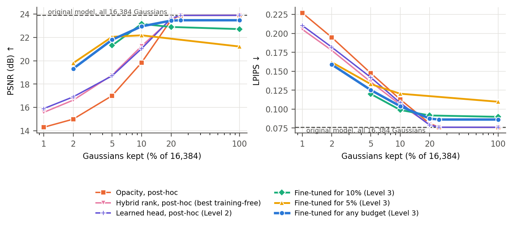

# Project status — "How many Gaussians are really needed?" (Taya's part)

*Last update: 20 November. Start here. This branch (`taya/dev`) holds the budget / compactness part of the project; Paul's symmetry part is on `paul/dev` (`reports/symmetry-results.md`).*

## The idea in three sentences

Splatter Image predicts one 3D Gaussian per input pixel, so every object gets 16,384 Gaussians, and 74 % of them are nearly transparent. We study **how many Gaussians are actually needed and which ones** (25 % down to 1 %), analyse everything per viewpoint, and then **train the model to work with a fixed budget of Gaussians** (budget-aware fine-tuning, a hard-constraint form of training for sparsity). Together with Paul's symmetry extension this gives one story: the one-Gaussian-per-pixel design wastes Gaussians (→ compactness, this branch) and guesses the hidden side poorly (→ symmetry, Paul).

## Where we are

| Part | Status | Main result (SRN Cars, 703 test cars) |
|---|---|---|
| Baseline reproduction | ✅ | 23.999 / 0.923 / 0.077 on the official protocol (paper: 24.00 / 0.92 / 0.078) |
| Viewpoint analysis of the full model | ✅ | U-shape: side views (90–120°) worst, opposite views (150–180°) better → symmetry |
| **Level 1** — training-free selection, 12 criteria + merging | ✅ | 25 % is free (−0.004 dB); at 10 % the free **hybrid** rank is best |
| **Level 2** — learned importance head + ablations | ✅ | head beats its teacher oracle (+0.75 dB at 10 %), 60× faster; Gaussian parameters alone suffice |
| **Level 3** — budget-aware fine-tuning | ✅ | **10 % of the Gaussians at -0.74 dB** (post-hoc best: -2.64 dB) |
| Level 3 — any-budget model (one model, nested budgets) | ✅ | close to the specialists at every budget; −0.43 dB at 100 % |
| Level 3b — Group DRO over viewpoints | ✅ (negative) | no effect: training losses barely depend on the angle |
| Cost benchmark + 360° video | ✅ | 10× less storage, ~2× less render memory at 512²; **no real speed-up** (render ~2 ms, overhead-bound) |
| **Combination with Paul's symmetry** | ⏳ code ready | budget fine-tuning starting from Paul's `sym_long` model (see "Next steps") |
| SRN Chairs | ⏳ not started | evaluation only |
| Report (CVPR template, 6 pages) / slides (24 Nov) / poster (1 Dec) | ✍️ | report deadline 5 Dec |

## Evaluation protocol (read before comparing numbers)

- **703 test cars**: car 375 (`876d92ce6a0e4bf399588eee976baae`) is blank in all 251 images and is excluded (same as in Paul's report). `analyze_level1.py` drops it automatically.
- **25 evaluation views per object** (odd novel views, evenly spaced); even views are used only by the oracle scores → no test leakage. Paul's tables use all 250 views (official `eval.py`), so absolute numbers differ slightly (full model 23.90 here vs 23.93 there); **differences between methods are comparable**.
- Paired per-object differences with 95 % CIs; masked PSNR (object pixels only) also reported.

## Key results

### Level 1 + 2: which Gaussians to keep (original model, no training of the reconstructor)

| Criterion | PSNR @10 % ↑ | LPIPS @10 % ↓ | PSNR @5 % | PSNR @1 % | worst angle bin @10 % | selection |
|---|---:|---:|---:|---:|---:|---:|
| Full model (100 %) | 23.90 | 0.076 | — | — | — | — |
| Random | 17.29 | 0.181 | 15.63 | 13.94 | -11.1 dB | 0.2 ms |
| Opacity | 19.84 | 0.113 | 17.00 | 14.29 | -5.7 dB | 0.1 ms |
| Opacity × area | 21.20 | 0.113 | 19.32 | 16.10 | -6.8 dB | 0.3 ms |
| **Hybrid rank** (opacity + opacity × area) | 21.25 | 0.106 | 18.77 | 15.57 | -5.0 dB | 1.5 ms |
| Edge + opacity (PhGS-style) | 17.02 | 0.144 | 15.83 | 14.20 | -8.0 dB | 0.4 ms |
| Contribution oracle | 20.29 | 0.108 | 18.13 | 14.90 | -11.0 dB | 26.9 ms |
| Contribution, iterative + angle-balanced | 20.50 | 0.106 | 19.12 | 16.22 | -9.1 dB | 129.7 ms |
| Error-sensitivity oracle | 19.46 | 0.117 | 17.17 | 14.65 | -9.0 dB | 27.8 ms |
| Merge 4×4 (keeps 6.25 %) | 21.34 | 0.176 | — | — | — | 72 ms |
| **Learned head (Level 2)** | 21.04 | 0.108 | 18.71 | 15.89 | — | 0.5 ms |

- **75 % of the Gaussians are free.** Below 25 %, cheap rules beat the expensive oracles in PSNR; the oracles are better in LPIPS; iterative re-scoring helps the oracle at small budgets.
- **Importance depends on the viewpoint**: the oracles collapse near the input view (−11 dB at 30–60°) because few test views lie there; the hybrid rank is the most robust.
- **Edge prior (PhGS-style) ≈ random** on objects; **merging** has good PSNR but is blurry.
- **Learned head**: beats its teacher, matches its LPIPS, 0.5 ms, no renders. Ablations (validation overlap with the oracle / test PSNR@10 %): Gaussian parameters only ≈ all inputs; RGB only < opacity; ranking ≈ MSE; error-sensitivity target is a bad teacher.

### Level 3: budget-aware fine-tuning (the main result)

Same number of Gaussians in every column (hybrid rank, or the learned mask where stated); 100 % = no pruning.

| Model | 2 % | 5 % | 10 % | 20 % | 100 % |
|---|---:|---:|---:|---:|---:|
| Original model + hybrid (post-hoc) | 16.62 | 18.77 | 21.25 | 23.56 | 23.90 |
| Control fine-tune (no budget) + hybrid | — | 18.73 | 21.18 | — | 23.88 |
| Fine-tuned for 10 %, learned mask | — | 21.09 | 22.92 | 22.70 | 22.58 |
| **Fine-tuned for 10 %, hybrid mask** | — | 21.31 | 23.16 | 22.90 | 22.71 |
| **Fine-tuned for 5 %, hybrid mask** | 19.80 | 22.05 | 22.18 | — | 21.22 |
| **Fine-tuned for any budget** (random k ∈ {5,10,20,100} %) | 19.32 | 21.80 | 22.95 | 23.44 | 23.47 |

- **Fine-tuning for the budget, not extra training, is what helps**: the control fine-tune changes nothing (−0.02 dB).
- **FT-10 (hybrid mask): 23.16 dB with 10 % of the Gaussians, +1.91 ± 0.08 dB over post-hoc hybrid** at the same count; **FT-5: +3.29 ± 0.11 dB** at 5 %.
- **The fixed hybrid mask beats the learned mask** (stable target → easier to adapt to).
- **Specialists overfit their budget** (FT-10 at 20 % / 100 % is below the original); the **any-budget model** fixes this almost completely, and its Gaussians are nested (take the first 2 / 5 / 10 / 20 %). It also became sparse by itself: same PSNR at 25 % and 100 %.
- **All viewpoints improve**, most near the input view: at 10 %, worst angle bin −5.04 → −1.77 dB.
- **Level 3b (Group DRO over 30° angle bins)**: identical to the control (bin weights stay ≈ 1 because training losses barely depend on the angle; the side-view difficulty is a generalisation effect). Honest negative result, consistent with Sagawa et al. (2020).

### Cost (full A100, 10 cars)

Storage 1.51 → 0.15 MB per object at 10 %; peak render memory at 512² 16.5 → 9.2 MB; render time ~1.6–2.1 ms per frame at 128²–512² for every variant (≤1.3× speed-up); U-Net forward 24 ms dominates. See `results_summary/cost/`, plus the side-by-side 360° video and the image strip.



## Files

| File | What it does |
|---|---|
| `importance.py` | selection criteria (opacity, opacity × area, hybrid, edge, contribution / iterative / balanced oracle, error sensitivity), merging, importance head, ranking loss, straight-through top-k mask, helpers for the **symmetric model** (originals + twins) |
| `eval_budget.py` | evaluates criteria × budgets in one pass (`--experiment_path`, `--ckpt` for fine-tuned / symmetric models) |
| `train_head.py` | Level 2: trains the importance head on the frozen model |
| `finetune_budget.py` | Level 3 / 3b: `--mask none|learned|hybrid`, `--keep`, `--keep_choices` (any-budget), `--view_weighting dro|fixed`, `--init_path` (start from e.g. Paul's `sym_long`); warm-up, EMA, cosine lr, cached validation, resume |
| `benchmark_cost.py` | render time / memory at 128²–512², 100-frame 360° timing, side-by-side video and image strip |
| `analyze_level1.py` | merges CSVs, drops blank objects / empty views, paired deltas ± 95 % CI, angle tables, LaTeX tables, figures |
| `*.sbatch` | Slurm jobs (`finetune_sym.sbatch` runs from a checkout of `paul/dev`) |
| `results_summary/` | final tables (LaTeX + CSV/MD), figures, cost table, video — all on 703 cars |
| `docs/` | project plan (incl. Level 3b and literature) |

## How to reproduce (cluster)

```bash
# Level 1 (all criteria x budgets on the test set)
sbatch budget_eval.sbatch
# Level 2 (importance head)
python train_head.py cars --num_workers 5 --steps 20000 --lr 1e-3 --out runs/head_A
# Level 3 (10 h each; best checkpoint by validation)
sbatch --export=ALL,ARGS="--mask hybrid --keep 0.10 --lr 5e-6 --hours 10 --out runs/ft10_hybrid" finetune.sbatch
sbatch --export=ALL,ARGS="--mask hybrid --keep 0.05 --lr 5e-6 --max_iters 6000 --decay cosine --out runs/ft5_hybrid" finetune.sbatch
sbatch --export=ALL,ARGS="--mask hybrid --keep_choices 0.05 0.1 0.2 1.0 --lr 5e-6 --max_iters 12000 --decay cosine --out runs/ft_anybudget" finetune.sbatch
# evaluation of a fine-tuned model
python eval_budget.py cars --experiment_path runs/ft10_hybrid --ckpt model_best.pth --criteria opacity hybrid --budgets 0.2 0.1 0.05 --out results/test_ft10_hybrid
# cost benchmark + video (full A100)
sbatch bench.sbatch
# analysis on a laptop
python analyze_level1.py results/budget_full_part --out results/analysis
```

## Next steps

1. **Combination with symmetry (needs from Paul: `experiments_out/sym_long/` with `.hydra/config.yaml` + model, and the plane-predictor checkpoint):**
   - A (no training): Paul's symmetric model + hybrid on the *stored originals* (twins follow) at 20 / 10 / 5 %;
   - B (training, ~4 h each): budget fine-tuning starting from `sym_long` — `--init_path runs/sym_long --keep 0.10` and the any-budget version. Clean 2×2: {original, symmetric} × {post-hoc, budget fine-tuning}. Question: does storing 10 % + the plane come close to the full original model?
2. Merge `taya/dev` and `paul/dev` into `main`; clean repository structure and README (course checklist).
3. Report (6 pages: Abstract, Intro, Related Work, Methodology, **Datasets**, Experiments & Results, Conclusions; GitHub link at the end of the abstract), slides for 24 Nov, poster for 1 Dec.
