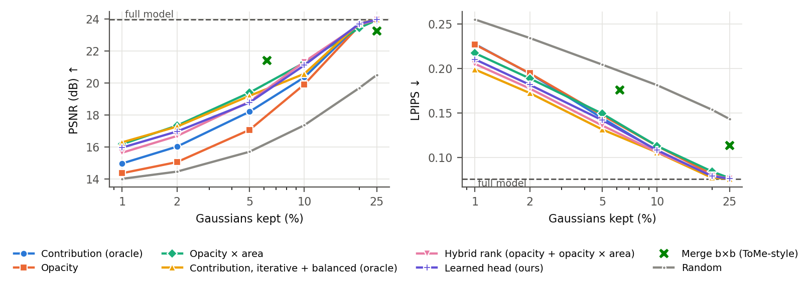

# Project status — "How many Gaussians are really needed?"

*Last update: 17 November. Start here. Everything important is linked from this file.*

## The idea in three sentences

Splatter Image predicts one 3D Gaussian per input pixel, so every object gets 16,384 Gaussians, and 74 % of them are nearly transparent. We study **how many Gaussians are actually needed and which ones**, from 25 % down to 1 % of the Gaussians, and analyse everything per viewpoint (angle between the input and target camera). On top of training-free criteria we train our own components: a learned importance head (Level 2), budget-aware fine-tuning (Level 3) and viewpoint-robust fine-tuning (Level 3b).

Full plan, research questions, day-by-day schedule and risks: [`docs/project_plan_v2.md`](docs/project_plan_v2.md) (the original proposal is [`docs/project_overview.md`](docs/project_overview.md)).

## Where we are

| Part | Status | Main result |
|---|---|---|
| Baseline reproduction | ✅ done | PSNR 23.999 / SSIM 0.923 / LPIPS 0.077 on 704 test cars (paper: 24.00 / 0.92 / 0.078) — see [`REPRODUCTION.md`](REPRODUCTION.md) |
| Viewpoint analysis of the full model | ✅ done (176,000 views) | U-shaped: worst at side views 90–120° (23.17 dB), better at 150–180° (25.14 dB) |
| **Level 1** — training-free selection, 12 criteria + merging, 704 cars | ✅ done | 25 % is free (−0.004 dB); at 10 % the free **hybrid** rank is best (21.32 dB vs 19.91 for opacity) |
| **Level 2** — learned importance head + ablations, 704 cars | ✅ done | head beats its teacher oracle (+0.75 dB at 10 %), 60× faster, but not the best free rules |
| Cost: storage | ✅ done (computed) | 1.51 MB → 0.38 MB (25 %) → 0.15 MB (10 %) per object |
| Cost: rendering time, 360° video | ⏳ to do | needs `benchmark_cost.py` (not written yet) |
| **Level 3** — budget-aware fine-tuning | ⏳ to do | patch for `train_network.py` described in plan §3 |
| **Level 3b** — viewpoint-robust fine-tuning (Group DRO over angle bins) | ⏳ to do | plan §9; shares the patch and the control run with Level 3 |
| SRN Chairs (evaluation only), demos (360° comparison video) | ⏳ to do | plan §8 |
| Paper (CVPR 2026 template) | ✍️ in progress | live version in Overleaf; snapshot in [`paper/cvpr_paper/`](paper/cvpr_paper/) |

## Key results

### Level 1 + Level 2, SRN Cars, 704 test objects (25 evaluation views each)

| Criterion | PSNR @10 % ↑ | LPIPS @10 % ↓ | PSNR @5 % | PSNR @1 % | worst angle bin @10 % | selection |
|---|---:|---:|---:|---:|---:|---:|
| Full model (100 %) | 23.96 | 0.076 | — | — | — | — |
| Random | 17.37 | 0.181 | 15.71 | 14.02 | −11.1 dB | 0.2 ms |
| Opacity | 19.91 | 0.113 | 17.08 | 14.37 | −5.7 dB | 0.1 ms |
| Opacity × area | 21.27 | 0.113 | **19.40** | 16.18 | −6.8 dB | 0.3 ms |
| **Hybrid rank** (opacity + opacity × area) | **21.32** | **0.106** | 18.84 | 15.65 | **−5.0 dB** | 0.7 ms |
| Edge + opacity (PhGS-style) | 17.10 | 0.144 | 15.91 | 14.28 | −8.0 dB | 0.4 ms |
| Contribution oracle | 20.36 | 0.108 | 18.21 | 14.98 | −11.0 dB | 30 ms |
| Contribution, iterative + angle-balanced | 20.57 | 0.106 | 19.20 | **16.30** | −9.1 dB | 130 ms |
| Error-sensitivity oracle | 19.53 | 0.116 | 17.25 | 14.73 | −8.9 dB | 28 ms |
| Merge 4×4 (keeps 6.25 %) | 21.39 | 0.176 | — | — | — | 72 ms |
| **Learned head (ours, Level 2)** | 21.11 | 0.108 | 18.78 | 15.97 | −5.7 dB | 0.5 ms |

Takeaways:
1. **75 % of the Gaussians are free** (−0.004 ± 0.001 dB with opacity or contribution).
2. **Cheap rules rival the oracles in PSNR**; the oracles are better in LPIPS. Iterative re-scoring improves the oracle by +1 dB at 5 % (accounts for redundant, overlapping Gaussians).
3. **Importance depends on the viewpoint**: the oracles collapse on views close to the input camera (−11 dB at 30–60°) because few test views lie there; the hybrid rank is the most robust.
4. **PhGS-style edge prior ≈ random** for objects on a white background.
5. **Merging** gives the best PSNR at 6.25 % but is blurry (worst LPIPS).
6. **Learned head** (Level 2): beats its teacher (+0.75 dB at 10 %, +1 dB at 1–2 %), matches its LPIPS, 60× faster, no renders. Does not beat the free hybrid rank.

### Level 2 ablations (validation overlap with the oracle's top-10 %, and test PSNR @10 %)

| Head variant | val overlap@10 % | PSNR @10 % | LPIPS @10 % |
|---|---:|---:|---:|
| Reference (all inputs, ranking loss, 8k it.) | 0.577 | 20.98 | 0.110 |
| Gaussian parameters only | 0.589 | 20.97 | 0.111 |
| Input RGB only | 0.409 | 19.22 | 0.129 |
| MSE instead of ranking loss | 0.576 | 20.82 | 0.113 |
| Error-sensitivity target | 0.686* | 18.02 | 0.126 |
| 20k iterations (final head `head_A`) | 0.581 | 21.11 | 0.108 |
| Opacity (no learning) | 0.494 | 19.91 | 0.113 |

\*measured against its own oracle (opacity: 0.464), not comparable. → **The predicted Gaussian parameters are enough; the image alone is not.** Loss and training length barely matter. lr = 1e-3 was chosen on the validation split (3e-4 / 1e-3 / 3e-3).

Full numbers: [`results_summary/level1/summary.md`](results_summary/level1/summary.md), [`results_summary/level1/angle_delta.md`](results_summary/level1/angle_delta.md), [`results_summary/level2/summary.md`](results_summary/level2/summary.md). Figures: [`results_summary/fig_budget.png`](results_summary/fig_budget.png), [`results_summary/fig_angle.png`](results_summary/fig_angle.png).



## Files in this branch

| File | What it does |
|---|---|
| `importance.py` | all selection criteria (opacity, opacity × area, hybrid, edge, contribution / iterative / angle-balanced oracle, error sensitivity), 2×2/4×4 merging, the importance head, ranking loss, straight-through top-k mask (for Level 3) |
| `eval_budget.py` | evaluates any set of criteria × budgets in ONE pass over the test set; odd views = evaluation, even views = oracle scoring (no leakage); writes `<out>_objects.csv` and `<out>_views.csv` (per view, with angle) |
| `train_head.py` | Level 2: trains the head on the frozen model, oracle targets computed on the fly; flags `--target`, `--inputs`, `--loss`, `--lr`, `--steps` |
| `analyze_level1.py` | merges CSV parts, removes empty-GT views, paired deltas ± 95 % CI, angle tables, LaTeX table, figures |
| `budget_eval.sbatch` | Level 1 on 704 cars, split into 4 array jobs |
| `eval_viewpoint_gap.py`, `eval_pruning.py` | earlier scripts (viewpoint analysis of the full model, first opacity pruning) |
| `docs/` | project overview and the current plan (incl. Level 3b and literature) |
| `results_summary/` | small summaries, tables and figures (raw CSVs are ~150 MB and stay on the cluster / Mac) |
| `paper/cvpr_paper/` | snapshot of the LaTeX paper (the live version is in Overleaf) |

## How to run (cluster)

```bash
# Level 1: all criteria x budgets on 704 test cars (4 jobs, ~1-2 h each)
sbatch budget_eval.sbatch
# quick test on 3 objects
python eval_budget.py cars --max_objects 3 --out results/smoke

# Level 2: train a head (~6 steps/s with 5 workers; 20k steps ~ 1 h)
python train_head.py cars --num_workers 5 --steps 20000 --lr 1e-3 --target contribution --out runs/head_A
# evaluate it on the test set
python eval_budget.py cars --num_workers 3 --criteria opacity opacity_area hybrid contribution learned \
    --head_ckpt runs/head_A/head.pth --out results/test_head_A

# analysis (on a laptop, needs pandas + matplotlib)
python analyze_level1.py results/budget_full_part --out results/analysis
```

### Cluster gotchas we hit (so you don't)
- **`SHAPENET_DATASET_ROOT`** in `datasets/srn.py` must point to the folder that contains `srn_cars/` (absolute path, no `~`).
- **Lazy dataset imports** (`datasets/dataset_factory.py`, committed) — otherwise CO3D/NMR asserts fail.
- **New rasterizer API** (dr_aa branch): `gaussian_renderer/__init__.py` needs `antialiasing=False` and `rendered_image, radii, *_ = rasterizer(...)`.
- **RAM leak**: `SRNDataset` caches every image it loads → OOM after a few hundred objects. Our scripts free the cache per object (`FreeCacheDataset`).
- **BeeGFS is slow per file** → use `--num_workers` (data loading is the bottleneck, not the GPU).
- **Slurm limits on `stud`**: max 2 running and 4 submitted jobs per user, and a per-user CPU cap; `3g.40gb` slices are usually free, `4g.40gb` often are not. Don't keep an interactive `srun` shell open while jobs wait.

## Next steps

1. **Level 3 + 3b**: one patch of `train_network.py` with `--budget_keep` and `--view_weighting {none,fixed,dro}`; launch 4 fine-tunes in parallel (control · budget 10 % · Group DRO angles · budget 5 % or fixed weights), ~20 h each.
2. **Cost benchmark + 360° comparison video** (`benchmark_cost.py`, one script for both; full A100 `7g.80gb`).
3. **SRN Chairs** (evaluation only) — tests whether the viewpoint findings depend on car symmetry.
4. Paper: Level 3 results, Cost (rendering time), Conclusion.
